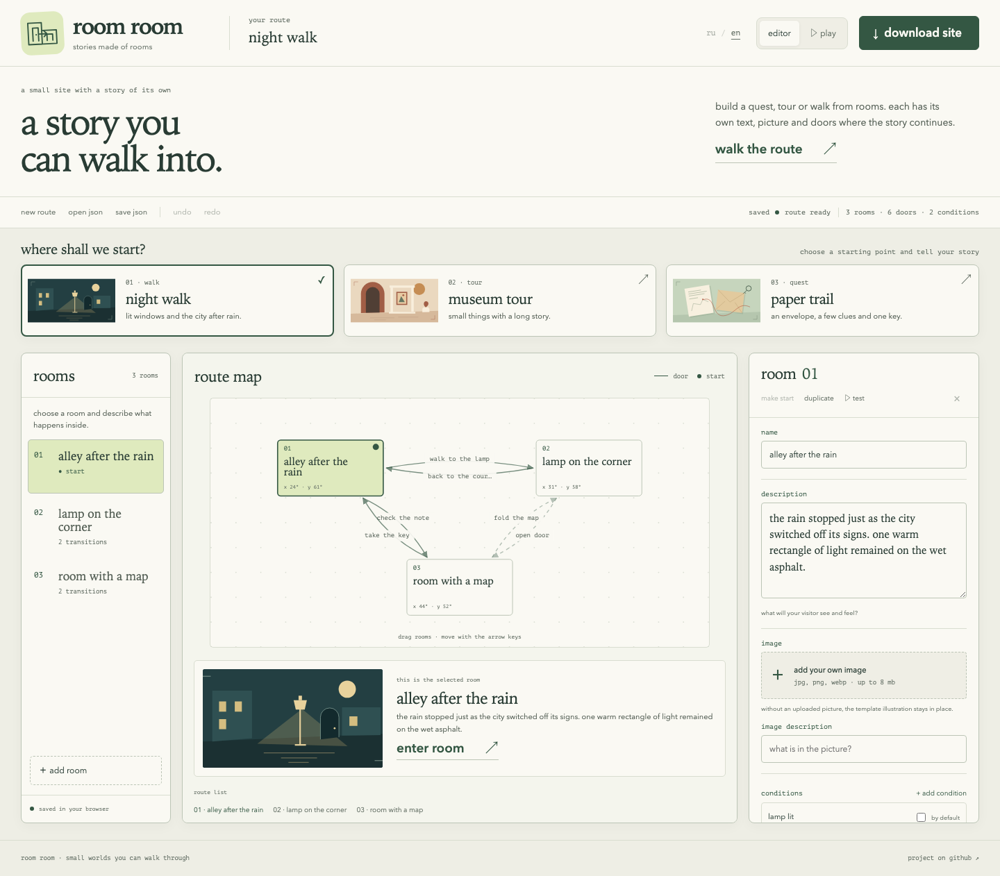
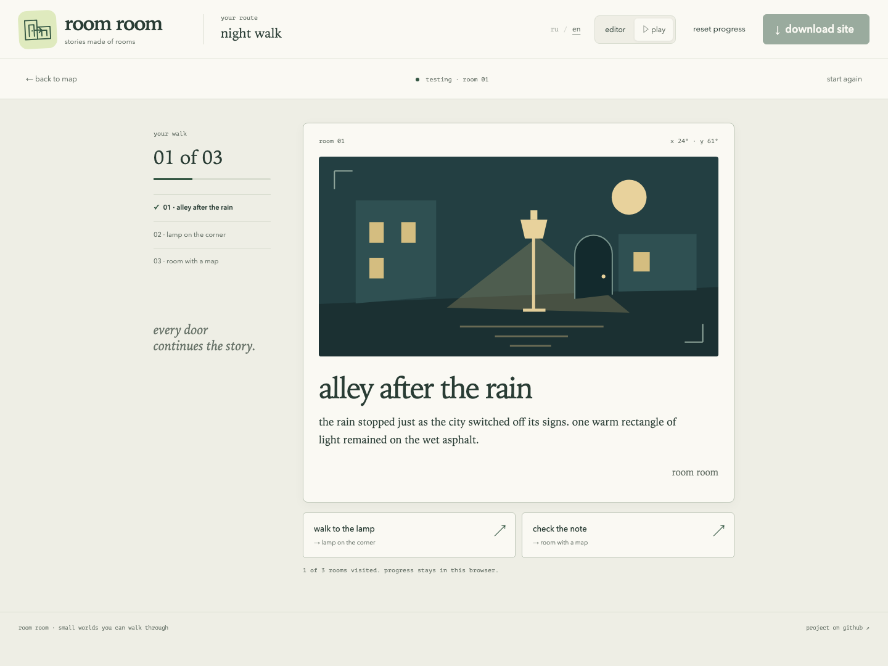
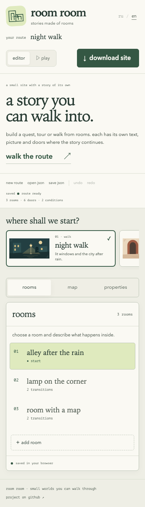

**english** · [русский](README.ru.md)

# room room

small sites you can walk through.

room room builds a story, tour or quest from rooms. each room has its own text, picture and doors. visitors choose where to go, find items and unlock new paths. download the finished route and host it on your own site.

[open the editor](https://chebaturkin.github.io/site-as-game/?lang=en) · [try the night walk](https://chebaturkin.github.io/site-as-game/?lang=en#/play/n1)



## what you can make

- a short story with a choice of paths;
- a tour of an exhibition, collection or a few places;
- a quest with notes, keys and locked doors.

start with a night walk, museum tour or paper trail. the templates include text, doors and illustrations. change them to tell your own story. the map shows how rooms connect; drag a room or use the arrow keys to arrange it. undo and redo keep route edits reversible.

## what visitors see

each room opens as its own scene. doors and their conditions appear below the text, with progress alongside.

<details>
<summary>walking the night route</summary>



</details>

## build a route

1. choose a template and name the route.
2. write the room text. the preview updates as you type.
3. keep the illustrations or upload jpg, png or webp images up to 8 mb.
4. connect rooms with doors. add conditions for a quest, such as finding a key.
5. choose **play** or **enter room** to test the route.
6. choose **download site** to get an independent zip with text, images and doors.

a route has 3 to 7 rooms, with up to 3 doors per room. the editor checks names and connections before export. errors need fixing; notes help you spot unreachable rooms or unused conditions.

on a phone, tabs open the rooms, map and properties.

<details>
<summary>the mobile editor</summary>



</details>

## save and publish

the draft and play progress stay in this browser’s `localStorage`. project text and uploaded images are processed on your device and are not sent to a server. **save json** and **open json** move a project between devices. clearing browser data removes the local copy, so download a separate backup of work you want to keep.

use json when you want to continue editing, and zip when you want someone to walk through the route. the zip contains `index.html`, `styles.css`, `play.js`, `project.json` and an `assets` folder. unzip it and open `index.html`. the route works from disk without a server. publish it by uploading the archive contents to a static host such as github pages.

## language

the header’s **ru / en** control changes the editor in place. a valid `?lang=ru` or `?lang=en` takes priority over a saved choice, then the first supported browser language, then english. edits, route progress and url parameters stay in place. fresh, untouched templates follow the selected language. after an edit, import or reload, your story stays as written. exported site controls use the selected language.

## run locally

open `index.html` in a browser, or start a server in the project folder:

```sh
python3 -m http.server 4173
```

then open the local editor in [english](http://localhost:4173/?lang=en) or [russian](http://localhost:4173/?lang=ru).

## development

the editor uses html, css and plain javascript. no build or dependency installation is needed to run it. project data is not sent to a server.

```sh
node --check app.js
node --test tests/i18n.test.cjs
node tests/route_model_test.mjs
node tests/export_security_test.mjs
```

browser checks need python, playwright and chromium. with the local server running:

```sh
python3 tests/browser_smoke.py
python3 tests/preview_export_test.py
python3 tests/map_layout_test.py
TEST_PORT=4173 python3 tests/route_model_test.py
I18N_URL=http://127.0.0.1:4173 python3 tests/i18n_browser.py
```

change `TEST_PORT` to use a different port. the preview check downloads a route and verifies that illustrations and uploaded images work from disk.

the workflow in `.github/workflows/` publishes the editor on github pages after a push to `master`. choose github actions as the pages source in the repository settings.

this is a small browser editor for one route at a time. it supports up to 7 rooms, 3 doors per room and 12 conditions. save different routes as separate json files. shared editing and cross-device sync are not available.
