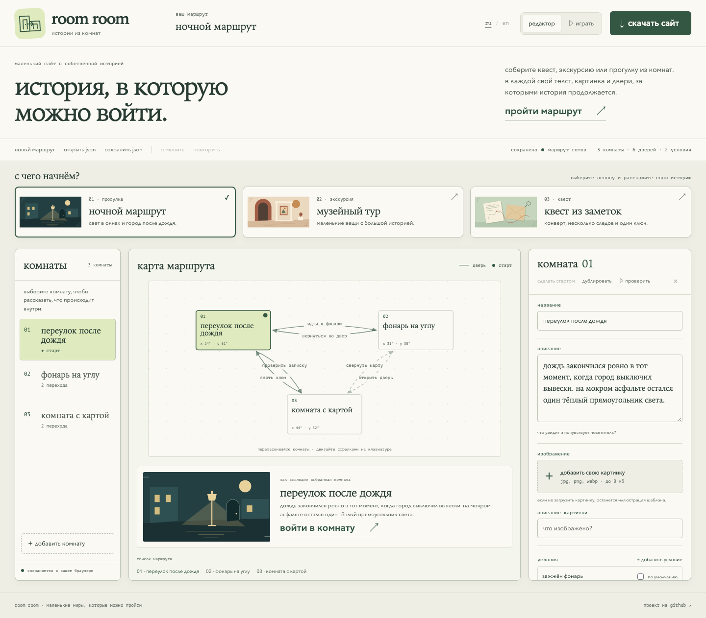
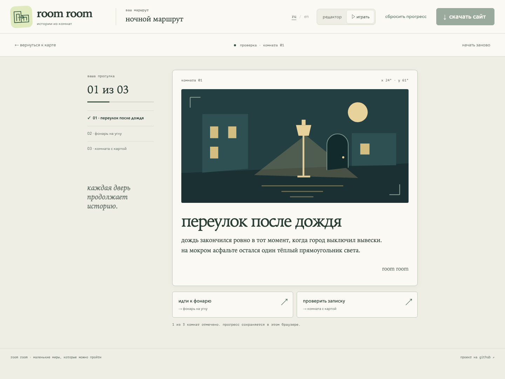
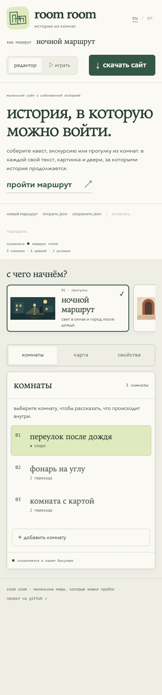

[english](README.md) · **русский**

# room room

маленькие сайты, по которым можно гулять.

room room помогает собрать историю, экскурсию или квест из комнат. в каждой свой текст, картинка и двери. посетитель выбирает, куда идти, находит предметы и открывает новые переходы. готовый маршрут можно скачать и разместить на своём сайте.

[открыть редактор](https://chebaturkin.github.io/site-as-game/?lang=ru) · [попробовать ночной маршрут](https://chebaturkin.github.io/site-as-game/?lang=ru#/play/n1)



## что можно собрать

- короткую историю с выбором пути;
- экскурсию по выставке, коллекции или нескольким местам;
- квест с записками, ключами и закрытыми дверями.

начните с ночной прогулки, музейного тура или квеста из заметок. в шаблонах уже есть текст, переходы и иллюстрации. всё можно изменить под свою историю.

## что увидит посетитель

у каждой комнаты своя страница. под текстом видны двери и условия перехода, а сбоку отмечается прогресс.

<details>
<summary>прохождение ночного маршрута</summary>



</details>

## как собрать свой маршрут

1. выберите шаблон и назовите маршрут.
2. напишите текст комнат. предпросмотр обновляется, пока вы редактируете.
3. оставьте встроенные иллюстрации или загрузите свои картинки: jpg, png, webp до 8 мб.
4. соедините комнаты дверями. для квеста добавьте условия, например найденный ключ.
5. нажмите `играть` или `войти в комнату`, чтобы проверить прохождение.
6. нажмите `скачать сайт`. редактор соберёт автономный zip с текстом, картинками и переходами.

в маршруте от 3 до 7 комнат, в каждой до 3 дверей. перед скачиванием редактор проверяет названия и переходы. ошибки нужно исправить, а замечания помогут найти недостижимую комнату или условие, которое нигде не используется.

на телефоне комнаты, карта и свойства открываются через вкладки.

<details>
<summary>редактор на телефоне</summary>



</details>

## сохранение и публикация

черновик и прогресс сохраняются в `localStorage` текущего браузера. кнопки `сохранить json` и `открыть json` позволяют перенести проект на другое устройство. если очистить данные браузера, локальное сохранение исчезнет, поэтому готовый черновик лучше скачать отдельно.

в zip входят `index.html`, `styles.css`, `play.js`, `project.json` и папка `assets` с изображениями. распакуйте архив и откройте `index.html`: маршрут работает с диска, без сервера. для публикации загрузите содержимое архива на статический хостинг, например github pages.

## запуск локально

откройте `index.html` в браузере или запустите сервер из корня проекта:

```bash
python3 -m http.server 4173
```

затем откройте [локальный редактор](http://localhost:4173).

## разработка

редактор написан на html, css и обычном javascript. сборка и установка зависимостей для запуска не нужны. данные проекта не отправляются на сервер.

проверки модели и безопасности экспорта:

```bash
node --check app.js
node tests/route_model_test.mjs
node tests/export_security_test.mjs
```

для браузерных проверок нужен python с playwright и установленным chromium. при работающем локальном сервере:

```bash
python3 tests/browser_smoke.py
python3 tests/preview_export_test.py
python3 tests/map_layout_test.py
TEST_PORT=4173 python3 tests/route_model_test.py
```

порт можно изменить через `TEST_PORT`. тест предпросмотра также скачивает архив и проверяет, что маршрут с иллюстрацией и загруженной картинкой работает с диска.

workflow в `.github/workflows/` публикует редактор на github pages после push в `master`. источник публикации в настройках репозитория: github actions.

это небольшой браузерный редактор. совместной работы и синхронизации между устройствами пока нет.

## язык

язык меняется через ru / en в шапке. явный `?lang=ru` или `?lang=en` важнее сохранённого выбора, затем учитывается первый поддерживаемый язык браузера. по умолчанию используется английский. свежий нетронутый шаблон меняется вместе с языком. после редактирования, импорта или перезагрузки его текст сохраняется как есть. данные, текущие поля и параметры ссылки при переключении остаются на месте.
